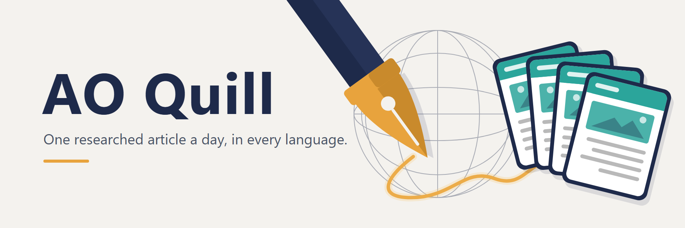

# AO Quill



**One new, researched article a day for your multilingual WordPress network, in every language, written and checked by your own AI engine.**

AO Quill reads your site, finds a subject your readers search for and you have not covered, researches it, writes it in your site's voice, picks categories, tags and images, checks its own work, translates it into every language of the network, checks every translation, and saves it all in one step: published, or waiting for your review.

Every factual sentence rests on a quote that was checked word for word against the page it came from. All model work runs on your own [AO](https://github.com/zlatko-lakisic/agentic-orchestration-reach) engine; nothing goes to a cloud AI service.

## Features

- **Topics people search for**: web search, Google search suggestions and trends in your audience's countries, compared with every post you already have.
- **Verified facts**: research with exact quotes, each one checked against the fetched page on the AO server.
- **Your voice**: a writing style learned from the posts your people wrote, per language.
- **Images that fit**: from your media library, Openverse and Wikimedia Commons, or web search, each checked by a vision model for fit, text, logos, watermarks and faces, with its license recorded.
- **Quality gates**: grammar, facts, style, SEO, structure, originality and length, each with a pass mark; failing drafts are revised.
- **Every language**: translated with TranslateGemma, checked for grammar, meaning (by translating back), style, structure, originality and writing system.
- **All or nothing**: every language is saved in one call and rolled back on any failure.
- **Full visibility**: every run, step, AO answer and score, live in WordPress; test runs that write nothing; resume a stopped run from any step, or from the language it was on.
- **Language sites**: copy the whole main site (settings, pages, tours, menus, posts) into a new language with one command, and translate the whole blog in a nightly window.
- **Instagram** (optional): a caption per language, posting when a post goes live, and a bio link to the newest post.
- **Private AI marking**: posts are marked in meta and a private taxonomy that visitors never see.

## How it is built

```
WordPress plugin  <── abilities, Application Password ──  worker  ── AO Reach (WebSocket, optional mTLS) ──>  AO engine
settings, schedule, run log,                              sequences the steps,                              every model call:
and every write to the site                               checks every answer                               writing, checks, vision, translation
```

| Folder | What it holds |
|---|---|
| [`wordpress-plugin/`](wordpress-plugin/) | The control plane: settings, schedule, run log, admin screens, and every write to the site, exposed to the worker as WordPress abilities |
| [`worker/`](worker/) | A thin Python client on AO Reach: runs the steps in a fixed order and enforces the gates. No model work, no state between runs |
| [`overlays/`](overlays/) | The AO agents the worker registers (analyst, writer, editor, structurer, vision, translator) |
| [`ao-server/`](ao-server/) | What the AO engine needs: deterministic quote and text checks, optional search providers |
| [`deploy/`](deploy/) | Container image, Kubernetes CronJob, systemd timer |
| [`docs/`](docs/) | Architecture, decisions, contracts, setup, operations, capability status |

## Quick start

1. **AO server**: enable session overlays and the MCP tunnel, install the deterministic checks ([`ao-server/INSTALL.md`](ao-server/INSTALL.md)).
2. **Plugin**: network activate it on a multisite with one site per language, write the site brief, set the AO connection ([`docs/setup.md`](docs/setup.md)).
3. **Worker**: on the WordPress server or any machine that reaches WordPress and AO:

   ```bash
   bash wp-content/plugins/ao-quill/worker/install.sh --wp-url https://example.com
   ~/.local/share/ao-quill-worker/run.sh check
   bash wp-content/plugins/ao-quill/worker/install.sh --cron
   ```

4. **Test run** from Network Admin, Settings, AO Quill, Post generation, then turn on the schedule.

The **[wiki](../../wikis/home)** covers installation, every setting, the daily run, quality checks, translation, language sites, Instagram, troubleshooting and development in detail.

## Requirements

| | |
|---|---|
| WordPress | 6.9 or later, subdirectory multisite with one site per language |
| PHP | 8.1 or later |
| Worker | Python 3.11 or later, Linux |
| AO engine | AO Reach v0.19.0, session overlays and MCP tunnel enabled |
| Search | SearXNG with the JSON format enabled |

## Tests

```bash
cd worker && python -m venv .venv && .venv/bin/pip install -e ".[dev]" && .venv/bin/pytest
cd ao-server/checks && ../../worker/.venv/bin/pytest
docker compose -f wordpress-plugin/tests-docker/docker-compose.yml run --rm phpunit
python scripts/build_contracts.py --check
```

## Status

What works today and what is planned: [`docs/capability-status.md`](docs/capability-status.md). Design decisions: [`docs/decisions.md`](docs/decisions.md).

## License

Apache-2.0. See [`LICENSE`](LICENSE).
